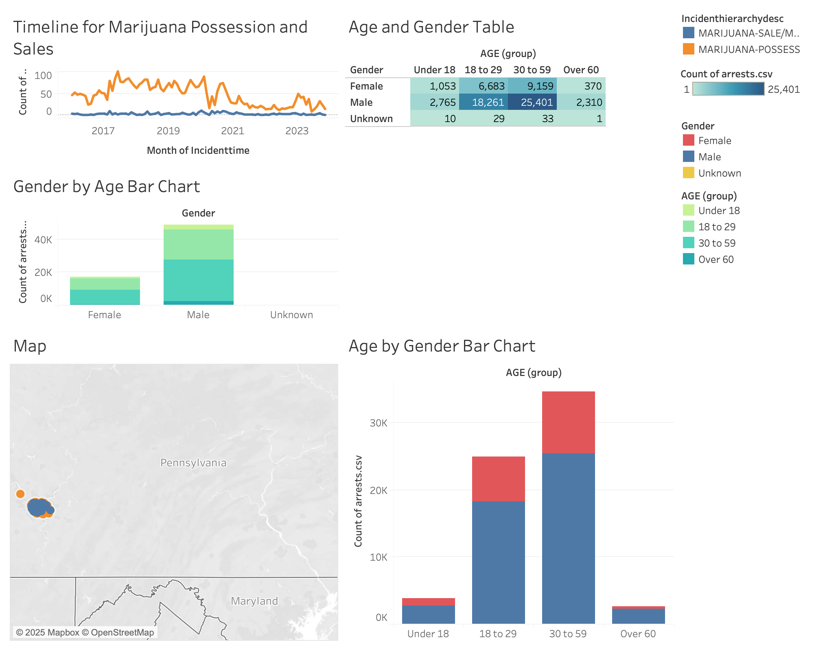
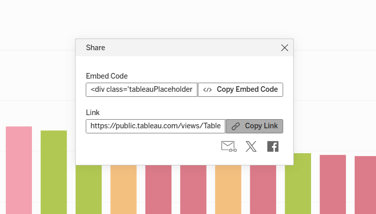

# Lab 2 · Tableau and Integration in Observable Dashboard

**67-290 Storytelling with Data Visualization · CMU-Qatar · Saturday 31 October 2026 · 90 minutes · 5 points**

This lab walks through publishing a Tableau visualization and embedding it into your Observable dashboard, either
directly in HTML or through an Observable notebook cell.

## Files in this folder

| File | Purpose |
|---|---|
| `README.md` | Full lab instructions (this page) |
| `data/arrests.zip`, `data/blotter.zip` | The two datasets for Part 1 |
| `images/` | Images used on this page |
| `tableau-embed.html` | Starter file for Option 1 (HTML embed) |
| `tableau-notebook.ojs` | Starter file for Option 2 (Observable embed) |

## Before class

1. To register for a Tableau Public Account, visit https://public.tableau.com/en-us/s/
2. Download [`data/arrests.zip`](data/arrests.zip) and [`data/blotter.zip`](data/blotter.zip) and unzip both. Save
   `arrests.csv` and `blotter.csv` to your desktop.

---

# Part 1 · Getting Started with Tableau

## Workshop Exercises

Sample output dashboard (see below)



Data for these exercises comes from the Western PA Regional Data Center website. Use the `.csv` files you saved to
your desktop before class:

- **Dataset 1:** Police Blotter Data (UCR Coded), `blotter.csv`: https://data.wprdc.org/dataset/uniform-crime-reporting-data
- **Dataset 2:** Arrests, `arrests.csv`: https://data.wprdc.org/dataset/arrest-data

To start, sign in at [public.tableau.com](https://public.tableau.com) and choose **Create → Web Authoring**. Tableau
Public does not save automatically, so publish your work now and then (see Exercise 8).

### Exercise 1: Connect to the Pittsburgh crime datasets

Our first exercise involves uploading our data into Tableau. We can do this from the 'Connect to Data' window. In this
window, we can see multiple places from which we can access datasets and the types of datasets we can add.

- **Connect to a dataset:** Choose 'Upload from computer'. From there, select one of the two city crime data files
  from your desktop (start with `arrests.csv`).
- Once you have uploaded this file, you will be taken to the 'Data Source' pane. You can switch to this pane at any
  time by selecting the 'Data Source' tab at the bottom of the Tableau window.
- We still need to add our second data set. From the 'Connections' section at the top left of the Tableau window,
  select 'Add'. From here, you will see a window pop up that looks like the connect page where we uploaded the first
  file. Follow the same process as above to add the second dataset.

Once at the data source pane, drag `blotter.csv` over to the large white space, next to `arrests.csv`. Tableau asks how
the two files are related.

- Under arrests.csv choose 'CCR', and under blotter.csv choose 'CCR (blotter.csv)', so that Tableau joins on the CCR
  field (this is a unique incident report number assigned to crime incidents in the blotter and arrest files).

**NOTE:** It is also possible to adjust our data fields in the 'Data Source' pane. You will notice that your data has
been entered into Tableau in a way similar to an Excel sheet, with columns and rows. However, unlike Excel our column
headers are separated from the rest of our data. Each column has a title, but they also have a small icon that
distinguishes the type of data entered within the rows of that column. You may notice that there are icons depicting
text ('abc') or numerical data ('#'), as well as date data (shown as a desk calendar) or geospatial data (shown as a
globe). You may also note that each icon is either blue or green. Blue icons relate to categorical or qualitative data,
which Tableau calls Dimensions. Green icons represent what Tableau determines is quantitative data (or Measures). You
can change your columns data type by right clicking on the icon and selecting which category, numerical or text,
measure or dimension, you would like to switch the data to.

Click on the Sheet 1 tab at the bottom of the window. We are now ready to start visualizing our data!

### Exercise 2: Build a contingency table of offender gender by age group

For our first visualization, let's make a table. In many cases, instead of making a graph, a table can be a great way
to visualize data so your audience can understand it quickly. Tableau also makes it easier to incorporate multiple
variables in many configurations to create attractive tables.

To make a contingency table in Tableau you need to work with both 'Dimensions' and 'Measures'. Dimensions represent
categorical data while Measures represent quantitative data. Tableau will automatically separate out what it thinks
are Dimensions into the Dimensions section on the left side of the screen, denoted by blue icons. Measures are located
under the Measures section with green icons, below a thin gray line. These icons relate to things that represent
either text ('abc') or numerical ('#') values. Additional icons represent geographic or temporal information.

- **Make a table:** To make a contingency table based on the offender's age and gender, we need to change our 'AGE'
  variable from a 'Measure' to a 'Dimension'. To do this, drag the 'AGE' variable from the Measure's section to the
  Dimension's section.
- Now that both AGE and 'Gender' are Dimensions we can create a table based on these variables.
- Drag Gender to Columns input and AGE to the Rows input.

You can see that there is now a table that compares AGE to Gender. However, all the places that should have values are
denoted by 'abc'. This indicates that there is no quantitative information currently available in this table.

- **Adding counts to a table:** To add our counts for each variable, select 'arrests.csv (Count)'. Drag this variable
  to the 'Text' box within the 'Marks' card, which is to the left of the graphing space and to the right of the
  Dimensions section. You will now see that there are counts of each group of offenders by age and gender.

However, this is not a very concise table. We can assume that it would be more useful to group different ages
together, to make the table easier to read.

- **Creating age groups:** To group our age variables together by increments of several years (Under 18, 18-25,
  26-40, 41-65, Over 65), start by creating the first grouping. This can be done by selecting at once all ages between
  10 and 17, by clicking on 10 in the table, holding the shift key down and clicking on 17. Once these have been
  selected a window will pop up with different options on how you can adapt the appearance and connection of these
  ages. Select the paperclip, which is Tableau's icon to group variables.

This will then combine the counts for ages between 10 and 17.

- **Rename groups and variables:** To rename the label for this group, right click on the label that now says
  '10,11,12…,17' and select the dropdown field Edit Alias. A new field will pop up, allowing you to relabel the grouped
  variables. Rename this field 'Under 18'.
- Now, continue to group the age variable to showcase counts of crimes by age and gender as age groups. For example,
  create groups for 18-25, 26-40, 41-65 and Over 65.
- **Exclude null values:** To further clean up the table, you can exclude null and incorrect values. In this dataset
  you may see age values for NULL, 0, 117 and 999. Simply right click on these and choose Exclude from the dropdown
  menu.
- **Reordering rows:** You can reorder the age groups by dragging and dropping. Move the Under 18 age group to the top
  of the column.
- **Adding color:** To add further context, you can drag the 'CNT(arrests.csv)' measures from the marks card variable
  to color. This will create a heat map within the table, with darker colors showing where the highest values are
  centered. To add in the text label, click the T icon located in the menu bar.
- **Adding totals:** To add more detail to our table, we can add totals fields. To do this, toggle from the 'Data' tab
  that shows our dimensions and measures, to the 'Analytics' tab. From here, click and drag 'Totals' to the table.
  Choose to add row or column totals.

### Exercise 3: Visualize offender age group and gender in a stacked or side-by-side bar chart

Now that we have made a table, it will be easy for us to explore the same information as a bar chart. Typically, bar
charts are a great way to compare values across categories as humans are adept at comparing lengths and have been
trained to do so in the context of a bar chart.

- **Create and name a new sheet:** Before we begin, start a new sheet. Label this sheet something that will be
  meaningful for your analysis, such as "Offender age Group and Gender".
- **Create a Bar Chart:** To create a bar chart based on gender and age, first bring the 'arrests.csv (Count)' variable
  to the columns bar. Then bring the grouped 'AGE' field from our 'Dimensions' table to the rows bar. This will be a new
  field based on the groupings we did in the last chart. It will be shown as the 'AGE' with a paperclip and not an '#'
  next to it.
- **Stacking variables:** We now have a bar chart showing Age by groups from exercise 2. To add gender to our
  visualization, drag 'Gender' to Color in the Marks card. You now have a stacked bar chart by our age categories, with
  Female designation represented in blue and Male represented in orange. You may want to change these colors, as your
  audience will likely associate the color blue with Male. This may cause them to misread your graph.
- **Working with color:** To change the color of 'Gender' within your visualization, click the 'Color' box within the
  'Marks' card. This will open a new window which allows you to edit the colors in your visualization, as well as the
  shade. Select 'Edit Colors'. This will pull up an additional window which will allow you to directly edit colors.
  You can either click on each variable color square to change it within the visualization, or you can select an
  entirely new color scheme with the dropdown bar under 'Select Palette'. Select the 'Traffic Light' option, then press
  'Assign Palette' to finalize your choice. Now your Male and Female color palette is less likely to confuse. If you
  like, you can also play around with other color palette options at any time.
- **Side-by-side bar chart:** You can also choose to represent these variables, age and gender, side by side. To do
  this, pull 'Gender' from the 'Dimensions' list to the rows bar. Make sure to place it after the 'AGE (group)'
  variable. This way the visualization will group all ages together, showcasing changing numbers of incidents for men
  and women of the same age side by side.
- **Grouped bar chart:** Additionally, if you would like to view Male and Female incidents separately, drag the
  'Gender' Variable before the 'AGE (group)' variable in the rows bar. This will reorder your visualization by Gender
  first.
- **Reordering rows and columns:** You can also order your columns or rows variables by dragging them into different
  positions along the axis bar. Try this by moving the 'Under 18' category to be first variable along the axis.
- To add color back to the graph, simply drag the 'Gender' pill from the Dimensions column to the color box within the
  marks card. The color choices from earlier in the exercise should still be in effect.
- Label and name your sheet.

### Exercise 4: Visualize marijuana sales vs. possession incidents by month

Line graphs are also excellent ways to view information, especially if that information is related to change over
time. To examine this, we can track changes for marijuana sales over time.

- **Using filters:** First, we need to use a filter to extract Marijuana sales and possession incidents from the
  'Incidenthierarchydesc' Dimension category. To do this, first drag the 'Incidenthierarchydesc' to the Filters card,
  above the Marks card. In the window that opens, choose to select only the variables we want; in this case, Marijuana
  sales and possession incidents or 'MARIJUANA-POSSESS' and 'MARIJUANA-SALE/MFG' (type MARIJUANA in the search box to
  find them), and click OK. Then right click on the 'Incidenthierarchydesc' pill and select 'Show Filter'. This will
  open up a list of all variable types on the right hand side of the Tableau window, where we saw the color key in
  earlier exercises. As we have selected only this information, our visualization will only return information on
  Marijuana related incidents.
- **Create a line graph:** To create a line graph that shows the trends in this information over time, take the
  'Incidenttime' from the Dimensions field and place it in the columns bar. Then, bring 'blotter.csv (Count)' over to
  the rows bar. You should now have a line graph representing the total count of all Marijuana incidents between 2016
  and 2023 (some older reports are dated 2005). We can assume that these are the years that are included in our data
  set.
- In the columns bar, you can see that the 'Incidenttime' pill has converted to read years with a + mark in front of
  it. This is indicating that though Tableau will automatically show years associated with our variables, there is
  more information we can access through this pill. If we click the drill down button (plus mark in the year pill) we
  can move through to Quarters and, repeating the drill down function on the Quarters pill to Months. Remove Quarters
  from the columns bar. This creates a small multiples graph of incidents by month in every year.
- The reason that the years are shown as separate entities and not continuous is that years are still being treated as
  a Dimension (or categorical singular variables) rather than as a Measure (qualitative and 'continuous'). In order to
  view the change in marijuana sales over time as a continuous spread, we need to change the time pills in our columns
  bar from Dimensions to Measures. To do this, first remove months from the columns bar. Then right click on the year
  pill in the columns bar. In the drop-down list, you can see there are two years. The first year, which you can see
  is pre-selected, is our dimension (discrete) year value. Select the second year (or the measures year). This will
  change the year to a measures pill.
- You can now see one continuous spread of information for change in incidents over every year. If we drill down now,
  instead of keeping Year as an overarching category for Quarter to fall into, Quarter replaces Year. If we drill down
  again, we now have the continuous spread of data from the date of the first data point to the date of the last data
  point.
- To view 'MARIJUANA-POSSESS' and 'MARIJUANA-SALE/MFG' as separate lines within this graph, drag over the
  'Incidenthierarchydesc' pill from our the Dimension's List on the left hand side of the Tableau viewframe and drop it
  into the color box within the 'Marks' Card. This will automatically show 'MARIJUANA-POSSESS' and
  'MARIJUANA-SALE/MFG' as two separate lines and in different colors.
- Save and label your sheet.

### Exercise 5: Create a map of all crimes color-coded by council district

- Add a new sheet. We will now make a map that will showcase the spatial nature of this data set.
- To do this, we first need to transition the X and Y coordinates from numerical fields to geospatial fields. Use the
  'X' and 'Y' in the arrests.csv list. Right click on the 'X' pill in the measures column. From the
  resulting drop down menu select geographic role, then Longitude. Repeat this process with the 'Y' pill, but select
  Latitude. You can now use these two pills as geographic coordinates.
- Now take the 'X' pill to the columns bar and the 'Y' pill to the rows bar. There should now be a map in the
  visualization space. (Note: Your data should be filtered to only Marijuana incidents, as in Exercise 4)
- To bring out our Pittsburgh points, we need to adjust our 'X' and 'Y' pills so they are not represented as an
  average value. To do so, right click on each of the geographic pills in the columns and rows bars. From the resulting
  drop down menu change the pill from a Measure (which is automatically selected) to a Dimension.
- Now refocus the map by hovering your mouse over the visualization pane and selecting from the pop up tab that appears
  on the left side of your map. This is the map control pane that will let you refocus the view of your map within the
  Tableau window. Choose the arrow at the bottom of the pop up bar—this will open more options to navigate the map.
  Click the button that has a square covered by a magnifying glass. This will allow you to drag a box over points on
  the map to zoom into those points.
- Next change the 'Council District' pill to a Dimension pill following the steps we used for 'AGE'. Then, bring the
  pill to the 'Color' box in the 'Marks' Card. You can see there are now multiple points that are colored by council
  district, which provides us some context for differences within the map. However, these points are still hard to
  distinguish.
- To make the map easier to read, drag the Measure pill 'arrests.csv (Count)' to the 'Size' box within the 'Marks'
  Card'. This will now create and order of size by number of events at any location. To make these changes easier to
  see, click on the 'Size' box within the Marks card; this will allow you to alter the size of each point within the
  map. Do so by dragging the resulting pop up window under the 'Size' marks card to the right. Making this change may
  be able to help us determine which council districts have the most marijuana related incidents.
- You can also see that there are now two keys next to our map on the right side of the visualization window, one for
  council district which is shown by color, and one for the number of incidents reported which is shown by size. This
  can also help provide additional context to the graph.
- Label and save your sheet.

### Exercise 6: Opening a Dashboard

Dashboards are a great way to showcase your results to the public or to do more complex analysis across
visualizations. In the Dashboard frame, you can showcase multiple visualizations at once.

To open a new dashboard:

- Select 'New Dashboard' icon
- Add our table and map graphs to the visualization pane by dragging them from the sheets menu
- As they are added, the sheets will snap to quadrants within the frame (if the objects field 'tiled' is selected)
- To change the position of the boxes, select 'floating'

Now that all three sheets are in our frame, we can see that the Key on the right side of the screen leaves a lot of
empty unused space in the frame, due to the way the Tiled option has placed them.

To bring these Keys closer to the visualizations

- Select the key and right click.
- Select the drop-down arrow.
- Select the option for 'floating'.
- Drag the key to lay over the correct visualization.
- Repeat with all keys.

To help with analysis in the Dashboard frame, you can set it so one graph can control what information is shown in
the other. This can be done by setting one graph as the 'Filter' for the whole Dashboard.

- Select table sheet within the main Dashboard screen. On the right hand side of the visualization, select 'use as
  filter'
- Try selecting different age groups from the table to see the map change shape.

You can also add new tiles, or windows, into our Dashboard space. To do this, look towards the section of the
Dashboard frame where we could select visualization framing as Tiled or floating.

You can also use Dashboards as a way to make a group of visualization look better laid out for a static image. This
can involve giving individual sheets within the data frames borders.

- Go to the 'Layout' tab.
- Go to the 'Item Hierarchy'
- Click the drop down option 'Tiled'.
- Select a sheet.
- Under border, select a line style.

Dashboards are also great because they allow you to control the format across all visualizations. to access format
options, go to the main menu at the top of the Tableau frame and select 'Format'- 'Workbook'. From here you can change
the text for titles and text within all visualizations.

Dashboards frame also allow you to see how your dashboard work space might look on different screens. To explore these
options, go to the 'Device Preview' button at the top left corner of the Dashboard frame.

### Exercise 7: Enhancing visualization

- **Titles:** At any time during your work, you have the option to add further context to your visualization. This can
  be done by giving a title to your work.
- You can do this in two ways. The first is to name the sheet itself. To name the sheet, right click on the tab for the
  sheet at the bottom of the window that you are working on and rename the file. This will automatically change the
  title at the top of your visualization.
- You can also change the title directly in the visualization frame by double clicking on the title itself.
- **Tool Tip:** To add more detail to your graphs, it is possible to add a point of information to your sheet to draw
  the eye of your audience. As we have been working in Tableau, you may have noticed that when you drag your cursor
  across the screen, when there is information in your sheet a small square of information on the point of data you
  are hovering over will pop up. In Tableau, this functionality is called Tool Tip. It is possible for you to edit your
  Tool Tip to reflect different types of information.
- To edit the Tool Tip, click on the 'Tool Tip' card within the 'Marks Card'. The 'Edit Tool Tip' box will open in the
  main visualization frame. Within this box it is possible to alter the tool tip text. You can do so by typing anything
  you want into the text field.
- Much like with the labels for our sheets being present in the title field, you will notice that the Tool Tip
  automatically shows all of the variable values visible within the visualization through greyed out text underneath
  the &lt;variable name&gt;. You can delete these and the values for deleted variables will not appear in the
  scrolling Tool Tip. If you want to re-add a variable, go to the 'Insert' drop down option and you will see all of
  the variables visible in the frame listed as well as other contextual information that can be automatically
  generated based on your graph, such as the 'Sheet Name' or the 'Data Source Name'.
- It is also possible to change the formatting of the text in your Tool Tip view through the Edit Tool Tip box.
- **Annotations:** If you want to publish your graph, it can be important to create a static annotation that will be
  visible in print. To achieve this, you can annotate your graph. To annotate your graph, right click on the point you
  wish to draw attention to.
- From the drop-down menu, select 'Annotate' and then 'Point'. A text box will open, allowing you to write something to
  describe or draw attention to this point. Write something and then click OK. You can now see this point of
  information included in the background of your graph over this point.
- Take time now to also play around with the other two types of annotation, 'Mark' and 'Area'.
- **Trend Lines:** It might be helpful add trend lines to your graphs, as they can provide more information on the
  p-value or r-squared value of your data spread.
- Go to the 'Analytics' tab.
- Drag 'Trend Line' onto the graph.
- **Calculated Fields:** One additional function that Tableau allows for making more complex analysis is the option to
  create our own 'Calculated Fields'. Calculated fields allow you to show results of certain variables when adapted by
  a calculation that will adjust the result.
- To create a calculated field, from the top menu in Tableau select 'Analysis' and then 'Create Calculated Field'.
- This opens the calculated fields view, where you can create new measure or dimension values by applying equations to
  your fields.
- To add dimensions or measures, type in the name of the pill.
- You can also add various pre-set functions from the side pane of the calculated field view.

### Exercise 8: Saving your work

There are several ways to save your work in Tableau. In Tableau Public, we save our work by publishing it to our
Tableau Public profile, which will enable us to work on our graphs in Tableau at a later date. However, if we want to
share our graphs, it might also be helpful save it as a .png.

- Click 'Download' on the toolbar and select 'Image'.

To upload your visualizations from your workbook to the internet:

- Click 'Publish As...' at the top right of the window
- Type a name for the workbook and click Publish
- After that, click 'Publish' whenever you want to save your changes
- To see your online graphic, click the X at the top right of the window

---

# Part 2 · Embedding a Tableau Visualization

Follow the steps below to find your Tableau URL, then embed it using either Option 1 (HTML) or Option 2 (Observable).
The two starter files, `tableau-embed.html` and `tableau-notebook.ojs`, are in this folder.

## Before You Begin: Get Your Tableau URL

Complete these steps first. You should have just created a Tableau visualization after following the tutorial in class!

In this lab, you will need your **Tableau viz URL** before filling out either template.

### PRE-STEP 1 — Publish your viz

- You should have already created your visualization in **Tableau Public**
- Make sure you published it to **Tableau Public**
- Make sure it is shared publicly (or with the appropriate permissions).

### PRE-STEP 2 — Copy your viz URL

- Open the published viz on Tableau Public.
- Click **Share** and copy the **Link** (not the embed code).
- Your URL will look like:

```
https://public.tableau.com/views/YOUR_WORKBOOK_NAME/YOUR_SHEET_NAME
```

📷 

> **Keep this URL handy** — you will paste it into the code in both options below.

---

## Option 1: HTML file (`tableau-embed.html`)

Open `tableau-embed.html` in **VSCode** and fill in each marked step.

### STEP 1 — Add the Tableau viz container

Inside `<body>`, paste the code below. Replace `YOUR_TABLEAU_URL` with the URL you copied in Pre-Step 2.

```html
<tableau-viz
  id="tableauViz"
  src="YOUR_TABLEAU_URL"
  width="100%"
  height="800px">
</tableau-viz>
```

### STEP 2 — Set the viz size

Inside `<head>`, paste:

```html
<style>
  #tableauViz {
    width: 100%;
    height: 800px;
  }
</style>
```

### STEP 3 — Load the Tableau Embedding API

After the `<tableau-viz>` element, paste:

```html
<script type="module"
  src="https://public.tableau.com/javascripts/api/tableau.embedding.3.latest.min.js">
</script>
```

**Done.** Open the file in a browser to run it.

---

## Option 2: Observable Notebook (`tableau-notebook.ojs`)

Open `tableau-notebook.ojs`. Each block is a separate cell in Observable.
Go to [observablehq.com](https://observablehq.com), create a new notebook, and add one cell per step. Cells 2 and 3
are HTML: before pasting, click the small **ts** label at the cell's top right and choose **HTML**.

### CELL 1 — Load the Tableau Embedding API

```js
import("https://public.tableau.com/javascripts/api/tableau.embedding.3.latest.min.js");
```

### CELL 2 — Viz size

```html
<style>
  tableau-viz {
    width: 100%;
    height: 800px;
  }
</style>
```

### CELL 3 — Tableau viz container

Replace `YOUR_TABLEAU_URL` with the URL you copied in Pre-Step 2.

**Important: Ensure you have deleted all tracking parameters from your URL so it ends cleanly with your dashboard
name. Remove everything from the ? onward.**

**Example of link:**

Before:
https://public.tableau.com/views/Lab3_17611071284150/Dashboard1?:language=en-US&:sid=&:redirect=auth&:display_count=n&:origin=viz_share_link

After:
https://public.tableau.com/views/Lab3_17611071284150/Dashboard1

```html
<tableau-viz
  src="YOUR_TABLEAU_URL"
  width="100%"
  height="800px">
</tableau-viz>
```

**Done.** The viz renders live inside the Observable notebook.

---

## Notes

- The viz must be published publicly, or the viewer must have Tableau Cloud/Server access.
- Interactive features — filtering, tooltips, and highlighting — remain available when embedded.
- The Tableau Embedding API v3 is the current standard; it uses a custom HTML element (`<tableau-viz>`) loaded via an
  ES module script.

---

# Submission

On Canvas, submit:

1. The link to your published **Tableau Public** dashboard (the URL from Pre-Step 2).
2. Your embed from Part 2:
   - **Option 2:** the link to your Observable notebook. Set it to **Unlisted** first (the globe icon in the
     notebook's sidebar), so we can open it.
   - **Option 1:** your `tableau-embed.html` file.

Full marks are for participating and finishing. If something broke and you could not fix it, say so and show us what
you tried.

Please take the remaining time in the workshop to explore changes to the graphs we have already made, including changing labels,
grouping variables, or changing effects with the options in your 'Marks Card'.

If you have any additional questions or wish to attend office hours to receive additional support with visualization
you made today or for a project, please email the TA: peidid@andrew.cmu.edu.
