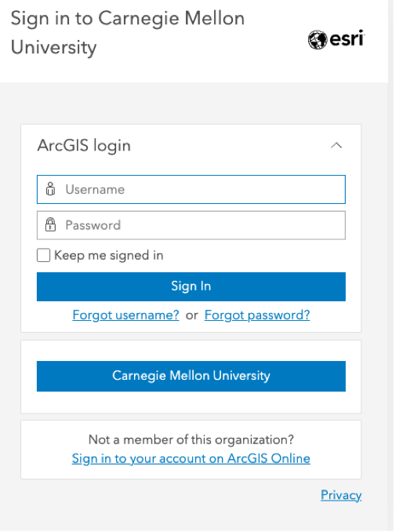
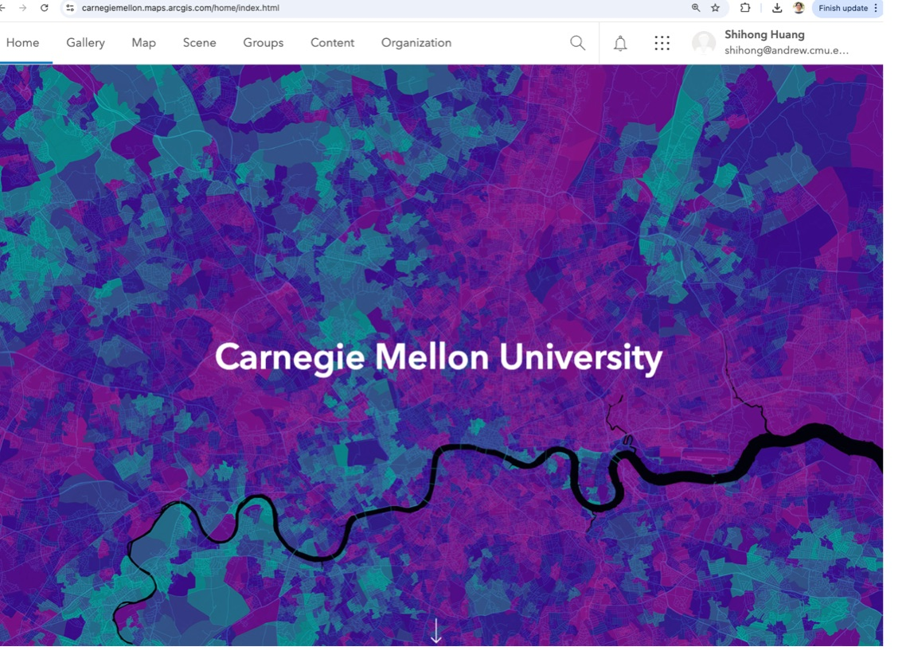
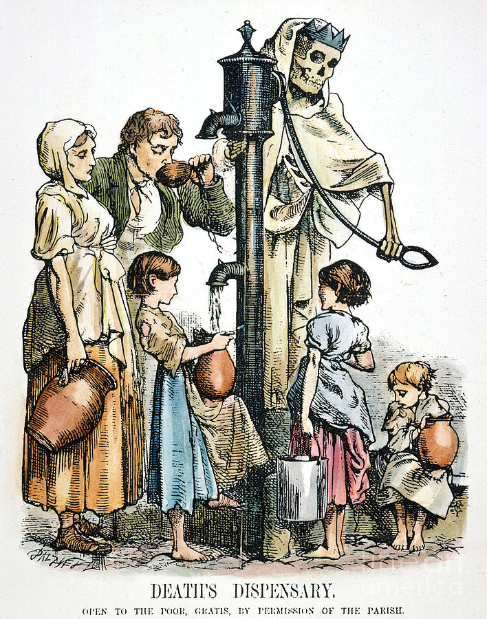
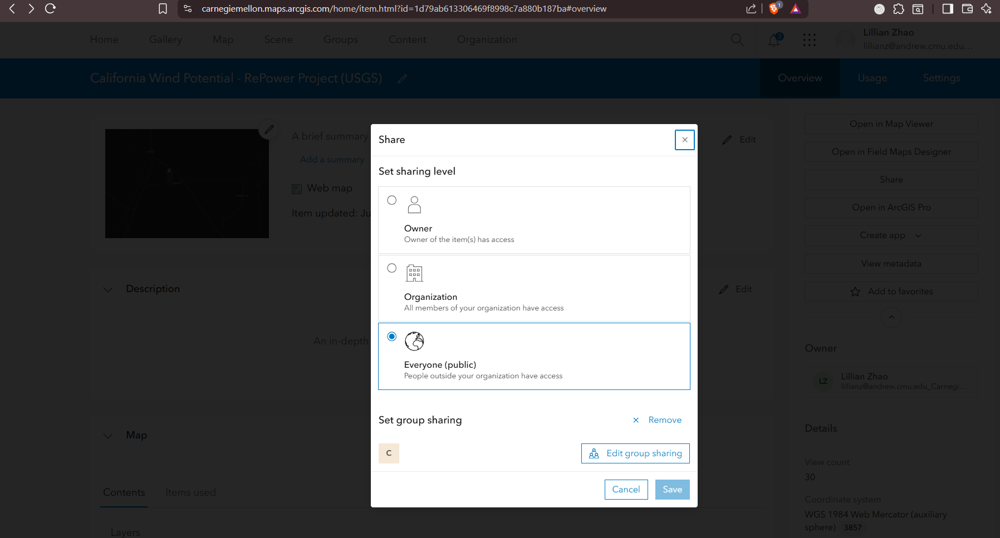
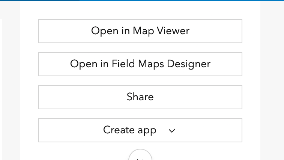

# Lab 3 · ArcGIS and Integration in Observable Dashboard

**67-290 Storytelling with Data Visualization · CMU-Qatar · Monday 9 November 2026 · 90 minutes · 5 points**

This lab walks through signing on to ArcGIS online account and creating storytelling with maps. This lab walks through
publishing an ArcGIS web map and embedding it into your Observable dashboard, either directly in HTML or through an
Observable notebook cell.

## Files in this folder

| File | Purpose |
|---|---|
| `README.md` | Full lab instructions (this page) |
| `images/` | Images used on this page |
| `arcgis-map.html` | Starter file for Option 1 (HTML embed) |
| `observable-notebook.ojs` | Starter file for Option 2 (Observable embed) |

## Before class: ArcGIS Account Access

Note: There is no need to download ArcGIS Pro desktop as the Heinz software site indicates. The Pro version will not
be used for our class. Rather, we will be using the ArcGIS Online product which requires no additional downloaded
software.

1. ESRI ArcGIS Software package access:

   https://www.heinz.cmu.edu/current-students/computing-services/software

   Or directly from

   https://carnegiemellon.maps.arcgis.com/home/index.html

   

2. Don't create a username and a password. Instead, click on "Carnegie Mellon University"
3. Sign in using your CMU credentials.
4. Once logged in, you should see the Carnegie Mellon University start page.

   

5. Click on the Map option at the top of the frame. A map showing Canada, the United States, Mexico and Central America
   should appear. If so, your account is good to go!
6. At this point, you can sign out of your account. We will explore the product during class sessions and do several
   practice exercises together. (Or, if you wish, feel free to experiment. There are tutorials online or you can view
   some recent student projects under the Gallery option.)

---

# Part 1 · ArcGIS Tutorial

### Exercise 1: Basic Earth Science: Earthquakes, Volcanoes and Tectonic Plates

In this exercise, we create maps that give us insight into some of our planet's natural seismic phenomena.

"An earthquake is a natural phenomenon characterized by the sudden shaking or trembling of the ground, caused by the
movement of tectonic plates beneath the Earth's surface. These movements can occur due to various factors, including
volcanic activity, the shifting of the Earths crust, or the release of stress accumulated along geological faults. The
energy released during an earthquake travels through the Earth in the form of seismic waves, which is what we feel as
shaking."

Earthquake magnitude is a measure of the size of an earthquake at its source. It is a logarithmic scale. For example,
the amplitude of seismic waves of a magnitude 5 earthquake is 10 times as large as a magnitude 4 earthquake. A magnitude
3 to 4.9 earthquake is considered minor; 5 to 6.9 is moderate to strong; 7 to 7.9 is major; and 8 or more is an
extremely powerful earthquake.

Earthquake intensity measures the strength of shaking and damage experienced at a specific location. The intensity of
an earthquake at a location is a number (I - XII) that characterizes the severity of ground shaking at that location by
considering the effects of the shaking on people, on built structures, and on the landscape.

**THE MAP**

From the home page of your CMU ArcGIS Online account, create a new map (Map option at the top). A base map should
appear. We next add various layers to visualize seismic activity.

Select the 'Add layer' option and, instead of 'My content', select 'Living Atlas'. In the Search box, enter
'Earthquakes'. A list of potential layers appears. Add the layer 'Recent Earthquakes' by ESRI to your map. The layer
appears on your map and the legend appears on the right of your work area. Note how the recent earthquakes are color
coded. You can collapse the Layers panel for a larger view of your map. Pan and Zoom around your map to see where
earthquakes occur globally. Click on a few for details.

Can you notice any patterns in the distribution of earthquakes? Of major earthquakes?

When you reach a convenient check point in your work, save your map (icon on the left; highlighted with a blue dot.)
Give your map a descriptive name and add some useful tags.

To add an additional layer, select either the Add option (plus sign) or Layers / Add. Again, select 'Living Atlas' and
search the term 'Volcano'. Add the layer 'Significant Global Volcanic Eruptions' to your map. Close the Layers pane and
note the legend on the right. Close that pane. Pan and Zoom around your map. If you open the Layers pane on the left you
can toggle each layer on and off or rearrange them.

Is there any apparent relationship between the locations of recent earthquakes and volcanic activity?

Add one more layer, this time from 'ArcGIS Online' rather than 'Living Atlas'. Search 'Tectonic' and add the layer
'Earth's Tectonic Plates' by ESRI Canada Education and Research. Hit the home button (lower right) to enlarge your map
to the default view. You can hide the Properties pane at the right and the Layers pane at the left. Save your map.

Pan and Zoom around your map. Do you see the 'Ring of Fire'? (Some of most densely populated countries and cities on
earth sit directly on the Ring of Fire. Name a few! Do you personally know any of these places?)

Finally, experiment with Base maps - the fourth icon in the left side panel. You will generally want to select base
maps that highlight the features you want to demonstrate in a useful and pleasing way. (Personally, I like 'Imagery
Hybrid' or 'National Geographic' for this application.)

You can see that adding layers to a map is an easy task; interpreting the underlying story is the challenge!

When you are happy with your work, save your map. When you return to ArcGIS Online, you will find it under Content.

When you are ready, we will try a filter function together.

### Exercise 2: California Fires

In this exercise, we create a map and a story map that illustrates the extent and dangers of recent California fires.

**THE MAP**

From the home page of your CMU ArcGIS Online account, create a new map (Map option at the top). A base map should
appear. We next add various layers to visualize the extent of major California fires.

Select the 'Add layer' option and, instead of 'My content', select 'ArcGIS Online'. In the Search box, enter
'California fires'. A list of potential layers appears. Add the layer 'California Historical Fire Perimeters' by
'California Department of ...' to your map. The layer appears on your map and the properties panel appears on the right
of your work area. Go ahead and close the properties panel.

Open the 'California Historical Fire Perimeters' layer. Note there are three layers contained within. We will examine
recent fires. Hide the 'California Fire Perimeters (1950+)' layer and show the 'Recent Large Fire Perimeters (GT 5000
acres)'. Save your map with a descriptive name and, optionally, some useful tags. Your map will be available in the
Content section of your account if you need to return to it.

Open the data table ( ... / Show table ). Can you identify the five largest fires, by name, since 2021? (Hint: Sort the
table on the 'GIS Calculated Acres') field. Many of these fires caused tremendous damage and loss of life. Select one of
the largest fires, zoom in on it, and do a quick bit of background research on it. Prepare a few facts about this fire
to present to the class - one minute, or less. (We'll call on a few students to present their findings.)

When you are happy with your work, again save your map. When you return to ArcGIS Online, you will find it under
Content.

**THE STORYMAP**

Next, we create a StoryMap to illustrate your findings.

Under the 9-dot array at the top (next to your name), select StoryMaps. Under the Create option, select 'Story'. A blank
template shows up.

Enter a descriptive story title (for example, maybe something like 'The Quarry Fire of 2023', with, of course, the name
of your chosen fire.) Add a short introduction or subtitle.

Your work is constantly saved and will be available in the Content section of your account, and will be present as an
option when you return to the StoryMap builder.

Download a dramatic and relevant 'cover' image for your story map. Add it to your story map where it will
appear at the top.

Under 'Design' select a Cover design and a Theme. Use one of the default themes or pick one from the Featured Themes
gallery. Your theme should complement the story you intend to tell.

Wherever you see a plus sign in green, can add content of various types. At the first green plus sign (Tell your
story), select Text, and add a brief paragraph or two explaining the situation. If you highlight your text, various
formatting options appear.

Next, under the plus sign, select Map and add your California Fires map. If you have created other maps, they will also
show up here. When you have selected your map, you can decide which layers you want to appear. Add some basic text below
the map to explain it.

Select the Preview option at the top of the map to preview your work at any time. Choose the small x at the bottom right
to return to the design/edit mode.

Optionally, add any other text, images, or other media that help your audience understand the story you are telling.

Note: If you make any changes to your original Cal Fires map in ArcGIS, these changes will be reflected in your StoryMap
the next time you load it.

### Exercise 3: The Famous London Cholera Map (1854)



Many people died in Europe during the deadly and recurring cholera epidemics. In times before modern bacteriology,
medicine, epidemiology and public health, there was great debate and misunderstanding about the causes and spread of
this disease.

In this exercise, we will re-create Dr. John Snow's famous 1854 map of the Soho region of London, one of the hardest hit
spots during this cholera epidemic. At the time of this epidemic (one of several in Europe and London) during the
1840's and 1850's, Dr. Snow had already become well known through his pioneering work in use of chloroform (having
helped deliver two of Queen Victoria's children) and his early work in what has become the field of epidemiology.

At the time, it was generally assumed, and accepted, that cholera was an airborne disease (miasma). Given the open
sewers in London (and elsewhere), the presence of livestock, the crowded conditions, and the general lack of proper
sanitation, there was plenty of reason to believe the miasma theory. Dr. John Snow, a resident of the area, thought
otherwise.

**Instructions:**

Sign into your ArcGIS Online Account: https://carnegiemellon.maps.arcgis.com/

Create a New Map (select Map from the top row of menu items).

Under Layers / Add / select 'ArcGIS Online' and enter cholera in the search box. Many results will be returned. To
narrow your search, you can use the 'owner' keyword. Add the clause owner:sappleton_Education to your search criteria.
Three layers should be returned: Snow's Cholera Map, Cholera Cases and Water Pumps, all authored by Sarah Appleton.

Add the layers: "Cholera Cases", "Water Pumps", and "Snow's Cholera Map" layers.

(The '<' returns you to the layers pane). Reposition layers, if necessary, so that the Water Pumps layer is on the top
and Snow's Cholera Map is on the bottom.

Snow's Cholera Map layer shows the Soho neighborhood as it would have mapped in 1854. It is a digital, or 'raster'
image, and has been 'georectified' to match the base map's spatial grid. He used tick marks in his original map to
indicate the number of deaths at each location. Cholera Cases shows the addresses where cholera deaths occurred along
with the number recorded. Water Pumps shows the location of water pumps throughout the area. Click on any point to see
relevant data.

Zoom to the extent of John Snow's Map and create a bookmark (sixth option on the left hand command bar) called 'Soho
1854'. This will make your map easier to find in the future. Save your map with a descriptive name (disk icon on the
left with blue dot.).

Experiment turning your layers on and off individually. Clicking on '…' in the Water Pumps or the Cholera Cases layer
brings up some additional options. Show the table for each to see the underlying data.

Next, we will do some styling to better visualize the situation. Select Layers and highlight the Cholera Cases layer. It
should be highlighted in gray. We will style the cholera deaths so that the symbols are in proportion to the number of
deaths at each location. Select the styles option on the right hand command bar. Under 'Choose attributes' add the field
'Deaths' as the attribute to show. The style changes to 'Counts and Amounts' as circles. Click on 'Style options' and
style symbols so that the maximum size is 30 px. Experiment with different colors or sizes so the map is easy to read
and interpret. 'Done' when ready to go on. Save your map with a descriptive name and, optionally, with useful tags.

Open the table for Cholera Cases ( ... Show table) and carefully examine the data. Note the attributes. Sort, in
descending order, by number of cases. What is the top address and how many deaths were there at this address? Select
the record (check the box) and note its location on the map. You can zoom to this location with the '… Zoom to
selection' option (header row of the table). Zoom back out (you can use your bookmark here!). Locate the next two most
deadly addresses and zoom in. Note that the rows you select will be faintly highlighted on your map.

Finally, style the Cholera Cases layer with a heat map and see if you can locate the epicenter of this outbreak of
cholera. Adjust the Area of influence so that your map is most illustrative. Save your map.

What might you (or Dr. Snow) conclude? How would you interpret Dr. Snow's original map? Can you explain why certain parts
of the areas in question seemed less likely to be infected?

Experiment with controls or style options as you wish and save your map frequently when you reach a good checkpoint.
(There is no 'easy' undo control.)

### Exercise 4: The Famous London Cholera Map (1854) - StoryMap


Open the London Cholera map you have already created. It should depict three layers - Cholera Cases, Water Pumps and
Snow's Cholera Map. Refer back to the case study if needed.

Next, we create a simple StoryMap to tell the story of Dr. Snow's map. Note the 9 dots matrix at the top of your work
area. Select 'StoryMaps'. A new tab should open into the StoryMap editor. In the upper right hand corner, select
'+Create / Story' and 'you should now be in the StoryMap editor. It is very simple to use and a great tool for telling
your story.

Begin by giving your story a descriptive title, like 'London Cholera - 1854' or something interesting. In the short
introduction or summary box, enter a one sentence description, like "The story of Dr. John Snow's famous Cholera map".
Your work is automatically saved in draft form as you make your edits.

Find and download an image that creates an interesting impression of the cholera epidemic and record the source of the
image (which we will use later for attribution). This will become your cover image. When ready, select 'Add cover image
or video' and upload your image. You are well on the way!

At the top of the work area, select Design and select theme or browse through the 'Featured themes gallery' to find one
that is appropriate for this most grim story. Turn on 'Credits'.

Wherever you see a plus sign in green, can add content. At the first green plus sign (Tell your story), select Text, and
add paragraph or two explaining the situation. Some like (or copy this one): "Many people died in Europe during the
deadly and recurring cholera epidemics. In times before modern bacteriology, medicine, epidemiology and public health,
there was great debate and misunderstanding about the causes and spread of this disease."

Add text again and add a second paragraph, like this (or copy this one):

"At the time, it was generally assumed, and accepted, that cholera was an airborne disease (miasma). Given the open
sewers in London (and elsewhere), the presence of livestock, the crowded conditions, and the general lack of proper
sanitation, there was plenty of reason to believe the miasma theory. Dr. John Snow, a resident of the area, thought
otherwise."

Next, add your Cholera Map. Under the plus sign, select Map and add your Cholera map. If you have created other maps,
they will also show up here. When you have selected your map, you can decide which layers you want to appear. For
example, you could deselect the Cholera Cases layer and only show the original map and the pump locations. Do so and
add some basic text below the map to explain it.

Select the Preview option at the top of the map to preview your work at any time. Choose the small x at the bottom right
to return to the design/edit mode.

Next, add your Cholera map once again, but also select the Cholera Cases layer. This should show your heat map. Add some
descriptive text.

Note: If you make any changes to your original Cholera map in ArcGIS, these changes will be reflected in your StoryMap
the next time you load it.

Add a credit for the image you downloaded and any other content or finishing touches you would like to complete your
basic StoryMap.

When you are ready to share your StoryMap, select Publish, and share it with your organization.

---

# Part 2 · Embedding an ArcGIS Map

Follow the steps below to find your map URL, then embed it using either Option 1 (HTML) or Option 2 (Observable).
The two starter files, `arcgis-map.html` and `observable-notebook.ojs`, are in this folder.

## Before You Begin: Get Your ArcGIS Map URL

Complete these steps first. You will need your **Web Map ID** before filling out either template.

### PRE-STEP 1 — Publish your map

- Find your map on **ArcGIS Online**
- Save the map, then share it publicly.



### PRE-STEP 2 — Copy your Web Map ID

- Open your published map in ArcGIS Online.
- Go to the Content tab
- Click on your map from Exercise 1
- Click on **Share** on the top right corner, below "Open in Field Maps Designer"



- Your Web Map ID is the value after ?id= in the URL

Example URL:

```
https://carnegiemellon.maps.arcgis.com/home/item.html?id=YOUR_WEBMAP_ID
```

> **Keep this ID handy** — you will paste it into the code in both options below.

---

## Option 1: HTML file (`arcgis-map.html`)

Open `arcgis-map.html` and fill in each marked step.

### STEP 1 — Add the ArcGIS CSS

Inside `<head>`, paste:

```html
<link rel="stylesheet" href="https://js.arcgis.com/4.32/esri/themes/light/main.css" />
```

### STEP 2 — Set the map size

Still inside `<head>`, paste:

```html
<style>
  #viewDiv {
    width: 100%;
    height: 800px;
  }
</style>
```

### STEP 3 — Add the map container

Inside `<body>`, paste:

```html
<div id="viewDiv"></div>
```

### STEP 4 — Load the ArcGIS SDK

After the `<div>`, paste:

```html
<script src="https://js.arcgis.com/4.32/"></script>
```

### STEP 5 — Add the map logic

After the SDK script tag, paste. Replace `YOUR_WEBMAP_ID` with the ID you copied in Pre-Step 2.

```html
<script>
  require([
    "esri/WebMap",
    "esri/views/MapView"
  ], (WebMap, MapView) => {

    const webmap = new WebMap({
      portalItem: {
        id: "YOUR_WEBMAP_ID"
      }
    });

    const view = new MapView({
      container: "viewDiv",
      map: webmap
    });
  });
</script>
```

**Done.** Open the file in a browser to run it.

---

## Option 2: Observable Notebook (`observable-notebook.ojs`)

Open `observable-notebook.ojs`. Each comment is a separate cell in Observable.
Go to [observablehq.com](https://observablehq.com), create a new notebook, and add one cell per step. Cells 1 and 4
are HTML: before pasting, click the small **ts** label at the cell's top right and choose **HTML**.

### CELL 1 — Map container

```html
<link rel="stylesheet" href="https://js.arcgis.com/4.32/esri/themes/light/main.css" />
<div id="viewDiv"></div>
```

### CELL 2 — Load the ArcGIS SDK

```js
window.dojoConfig = { baseUrl: "https://js.arcgis.com/4.32/dojo" };
await import("https://js.arcgis.com/4.32/init.js");
const require = window.require;
```

### CELL 3 — Map logic

Replace `YOUR_WEBMAP_ID` with the ID you copied in Pre-Step 2.

```js
require([
  "esri/WebMap",
  "esri/views/MapView"
], (WebMap, MapView) => {

  const webmap = new WebMap({
    portalItem: {
      id: "YOUR_WEBMAP_ID"
    }
  });

  const view = new MapView({
    container: "viewDiv",
    map: webmap
  });
});
```

### CELL 4 — Map size

```html
<style>
  #viewDiv {
    width: 100%;
    height: 800px;
  }
</style>
```

**Done.** The map renders live inside the Observable notebook.

---

## Notes

- The web map must be shared publicly.
- Interactive features (pan, zoom, pop-ups) work in both options.
- The web map ID is the `?id=` value in the ArcGIS item URL.

---

# Submission

On Canvas, submit:

1. The link to your London Cholera StoryMap (Exercise 4).
2. Your embed from Part 2:
   - **Option 2:** the link to your Observable notebook. Set it to **Unlisted** first (the globe icon in the
     notebook's sidebar), so we can open it.
   - **Option 1:** your `arcgis-map.html` file.

Full marks are for participating and finishing. If something broke and you could not fix it, say so and show us what
you tried.
