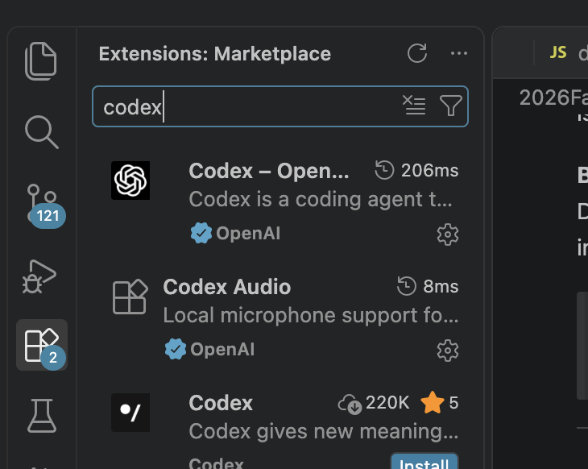
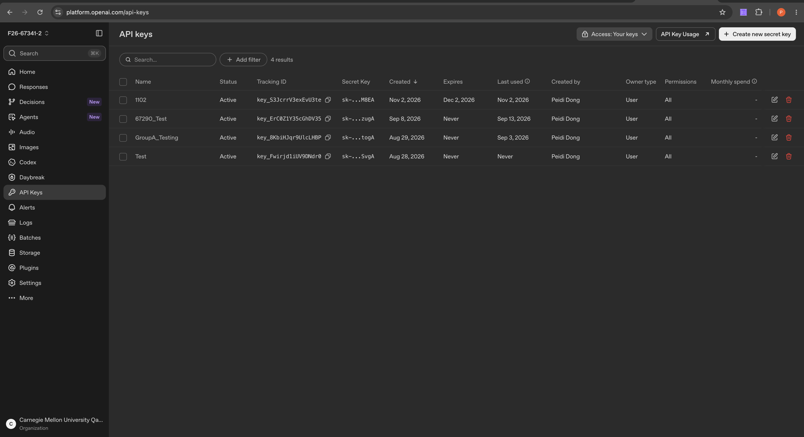
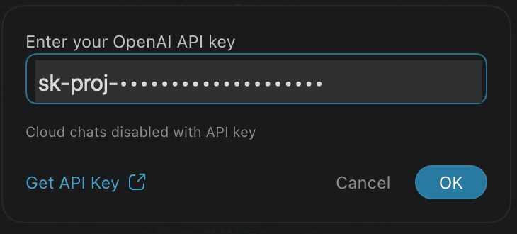
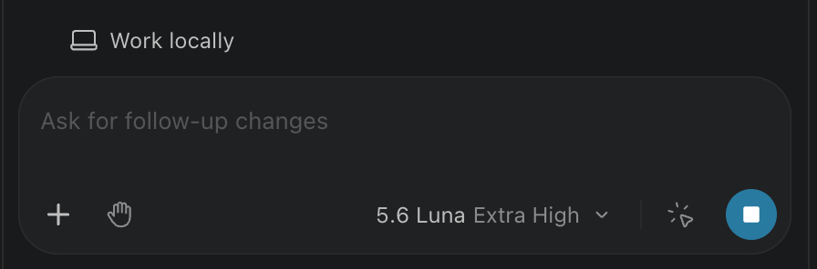
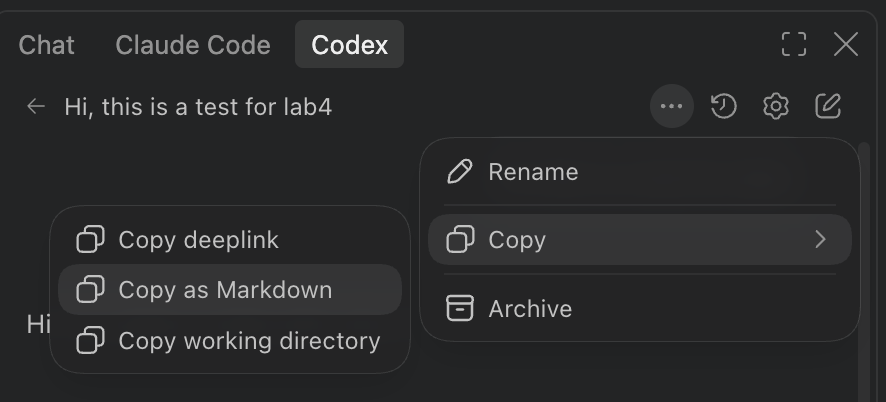

# Lab 4 · Agency and Taste: Direct the Agent

**67-290 Storytelling with Data Visualization · CMU-Qatar · Wednesday 18 November 2026 · 90 minutes · 5 points**

---

## The brief

> ### Tell a stranger something true about your home city/contry/region  that they could not have guessed, using data that did not all exist a year ago, and put it at a link that everyone can open on a phone.

You will work with the **Codex agent in VS Code** for the whole ninety minutes. It will find data, write
the fetch, parse it, and build the charts. **None of that is what you are graded on.**

Agents like Codex can now do most of the building, in minutes. That makes the **human in the loop** more important,
not less. An agent will happily build a confident chart on the wrong data, or five charts where two would do. What it
cannot bring is your **taste** (what is worth saying, and how) or your **judgment** about when its output is wrong.
Staying in control of a powerful AI tool is the skill this lab trains.

You are graded on the **decisions**: which story, which data, how many charts, what they say, and what you
refused. This lab is ninety minutes of proving that you can make them.

**Build it in Observable Framework**, the same way you did in Lab 1. Deployment is your call — the agent
knows several ways to put a site on the internet. Pick one, make it work, and be able to say why.

> **"Did not all exist a year ago"** — a live API (weather, air quality) satisfies this on its own. An
> annually updated source (World Bank, WHO) satisfies it if your story turns on the newest year.

---

## Get started: Codex in VS Code

1. **Install the extension.** In VS Code, open Extensions, search `codex` and install **Codex – OpenAI's coding
   agent** by OpenAI (the one with the blue verified tick):

   

2. **Create an API key.** You sign in to Codex with an API key offered by the university, not with a ChatGPT
   account. Log in to the [OpenAI API platform](https://platform.openai.com/home) with your CMU email, make sure the
   **Carnegie Mellon University Qatar** organization is selected (bottom left), open **API Keys** and select
   **Create new secret key**. Copy the key right away: you cannot view it again later.

   

3. **Sign in to Codex with your key.** Open the Codex panel, select **Use API Key** (not "Sign in with ChatGPT"),
   paste your key and select **OK**. Keep your key private: never paste it into the chat, your code or GitHub.

   

   

4. **Pick a model.** The university key offers two models: **gpt-5.6-luna** (shown as "5.6 Luna") and
   **gpt-5.4-nano**. Choose one at the bottom of the chat box:

   

---

## The one rule

**You lead this team; the agent reports to you.** It is fast and capable, and it will do whatever you ask, including
the wrong thing. So you stay in control: you make the decisions, the agent carries them out, and the result reflects
**your own taste**, not its defaults. In practice, that comes down to one rule:

> ### Don't let the AI take over your agency and taste.
>
> It can suggest and it can build, but the story, the data and every chart stay **yours**. Make each call in the
> chat before the agent acts. If you catch yourself just accepting whatever it proposes, stop and decide for yourself.

This is the whole lab. It is also the only thing that makes your chat history readable by someone else —
and your chat history is the main thing you are submitting.

---

## The six gates

Work through these in order. Do not let the agent skip ahead.

| | Gate | You decide | The agent does |
|---|---|---|---|
| 1 | **Story & reader** | The claim, in one sentence. Who is reading it. | Discusses ideas with you, if you ask. You make the call |
| 2 | **Source & route** | Which source, which endpoint, and why that one | Surveys what exists, explains each API |
| 3 | **Parse & verify** | Row count, units, what got dropped | Writes the loader, reshapes the response |
| 4 | **Views & encodings** | **How many charts, and why that many.** Chart type per question | Implements them |
| 5 | **Voice & order** | Style, colour, sequence, titles that state findings | Types it |
| 6 | **Ship** | Where it lives; check it on your phone | Deploys it |

**Gate 4 is the one with your name on it.** Every other class tells you to make three charts. Here the
number is yours, and you have to defend it. Two charts that each answer a real question beat five that
decorate.

---

## Six moves that keep you in charge

1. **Make it look before it writes.** Never let it guess field names — have it fetch one record and print
   the keys. *Real example: the Qatar portal's API calls a column `segment`; its own CSV export calls the
   same column `segment_type`. An agent that guesses writes a query that fails — or quietly returns nothing.*
2. **After any filter, ask: "how many rows did that drop, and which ones?"** Silent row loss is the most
   common way a correct-looking chart becomes a lie.
3. **Say no in words.** *"No — that's a pie chart with nine slices; use a sorted bar."* That is a decision.
   Silently fixing the code afterwards is also fine work, but it leaves no trace that you were the one deciding.
4. **Give it your taste once, in writing.** Five house rules at the start beats re-arguing every turn.
   For example: never truncate a bar axis · the title states the finding, not the variable · any rate names
   its denominator · sequential data gets a sequential scale.
5. **One gate at a time.** If it offers to build the whole thing, refuse. You cannot review what you did
   not watch being built.
6. **When it is confidently wrong about data, it is almost always units, denominators, or missing rows.**
   Check those three first.

---

## Where to get data

Finding the data is part of the work, and you do it with the agent at Gate 2. Ask it to survey what exists for your
story and explain each option. Then you choose the source, and say why that one.

---

## What to submit

**1 · Your chat history, as a `.md` file.** In the Codex panel, open the **···** menu at the top and select
**Copy → Copy as Markdown**. Paste it into a new `.md` file and submit that file. If you started more than one chat,
copy each one into the same file.

Your chat history, along with your live link, is what we look at. We read it to see whether you used the AI tool
wisely and stayed in charge, or gave up your agency and your taste to it. We look for four things:

- Is the story **yours**? Discussing it with the agent is fine, as long as you make the call.
- Is there at least one **"no"**, with a reason?
- Did you **question and challenge** the agent instead of just saying "okay", and have it **report back** to you,
  for example on what it dropped or assumed?
- Are there five or more turns where you **decide** something?

**2 · The live link.** It must open on a phone, for anyone, without a login.

---

## Grading · 5 points

| | |
|---|---|
| 4 | Your agency and taste, shown in your chat history: you stayed in charge and made the decisions (the four things under What to submit) |
| 1 | Your visualization link opens on a phone, for anyone, without a login |

Hit a wall, said so, and showed what you tried? **That keeps full marks.** A session where everything went
wrong and you stayed in charge of it is worth more than one where you said yes eleven times.
